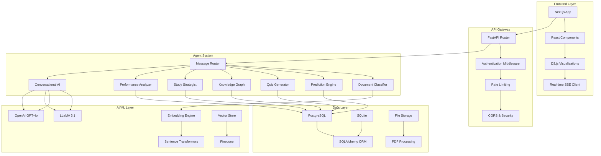

# 🏗️ Architecture Guide

## System Overview

ScholarGraph AI is a sophisticated academic intelligence platform built on a multi-agent architecture that combines cutting-edge AI technologies with modern web development practices.

## High-Level Architecture



## Core Components

### 1. Multi-Agent System

#### Message Router
- **Purpose**: Intelligent routing of user queries to appropriate specialized agents
- **Technology**: LangGraph workflow with pattern matching
- **Features**: Confidence scoring, fallback handling, context awareness

#### Specialized Agents
1. **Document Classifier**: Categorizes uploaded documents (syllabus, PYQ, notes)
2. **Prediction Engine**: Calculates probability scores for exam topics
3. **Quiz Generator**: Creates adaptive MCQs with difficulty adjustment
4. **Knowledge Graph**: Builds interactive topic relationship visualizations
5. **Study Strategist**: Generates personalized study plans
6. **Performance Analyzer**: Tracks mastery and identifies knowledge gaps
7. **Conversational AI**: Handles natural language queries with LLaMA/OpenAI

### 2. Probability Scoring Engine

#### Algorithm
```python
def calculate_probability_score(topic, historical_data):
    frequency = calculate_frequency(topic, historical_data)
    semantic_similarity = calculate_semantic_similarity(topic, embeddings)
    recency_weight = calculate_recency_weight(topic, historical_data)
    
    score = (0.40 * frequency) + 
            (0.35 * semantic_similarity) + 
            (0.25 * recency_weight)
    
    return classify_priority(score)
```

#### Components
- **Frequency Analysis**: Historical exam appearance patterns
- **Semantic Similarity**: Cosine similarity of topic embeddings
- **Recency Weighting**: Time-decay factor for recent topics
- **Priority Classification**: HIGH/MEDIUM/LOW categorization

### 3. Hybrid LLM System

#### LLaMA Integration
- **Model**: LLaMA 3.1 (8B parameters)
- **Deployment**: Local Ollama server
- **Optimization**: Quantized model, temperature=0.7, timeout=6s
- **Use Cases**: General knowledge, quick responses, cost efficiency

#### OpenAI Fallback
- **Model**: GPT-4o
- **Use Cases**: Complex reasoning, academic tasks, LLaMA failures
- **Features**: Higher accuracy, better coherence, reliable availability

#### Smart Routing
```python
def choose_llm(message_complexity, context_length, user_preference):
    if message_complexity < 0.7 and ollama_available:
        return ollama_llm  # Fast, local processing
    else:
        return openai_llm  # High-quality, reliable
```

### 4. Real-time Communication

#### Server-Sent Events (SSE)
- **Purpose**: Real-time chat streaming
- **Implementation**: FastAPI streaming responses
- **Features**: Token-by-token delivery, connection management, error handling

#### WebSocket Alternative
- **Use Case**: Future bidirectional communication
- **Technology**: Socket.IO or native WebSockets
- **Benefits**: Lower latency, full duplex communication

### 5. Data Architecture

#### Database Schema
```sql
-- Core entities
tenants (multi-tenancy)
users (authentication, profiles)
documents (file metadata, processing status)
topic_scores (probability calculations)
chat_sessions (conversation management)
chat_messages (message history)

-- Academic entities
quiz_questions (generated assessments)
quiz_attempts (user responses)
performance_records (mastery tracking)
study_plans (personalized schedules)
knowledge_graph (topic relationships)
```

#### Vector Storage
- **Provider**: Pinecone (production), In-memory (development)
- **Embeddings**: Sentence-Transformers (all-MiniLM-L6-v2)
- **Indexing**: Hierarchical clustering for efficient retrieval
- **Search**: Semantic similarity with cosine distance

### 6. Frontend Architecture

#### Component Structure
```
src/
├── app/                    # Next.js App Router
│   ├── page.js            # Home page
│   ├── chat/              # Chat interface
│   ├── dashboard/         # Analytics dashboard
│   └── upload/            # Document upload
├── components/            # React components
│   ├── chat/              # Chat UI components
│   ├── dashboard/         # Dashboard widgets
│   └── common/            # Shared components
└── lib/                   # Utilities and helpers
```

#### State Management
- **Global State**: React Context API
- **Local State**: useState, useReducer
- **Server State**: React Query/SWR
- **Form State**: React Hook Form

#### Real-time Features
- **Chat Streaming**: SSE client with token accumulation
- **Dashboard Updates**: WebSocket notifications
- **Live Progress**: Real-time processing status

## Security Architecture

### Authentication & Authorization
- **JWT Tokens**: Stateless authentication
- **RBAC**: Role-based access control
- **OAuth**: Third-party authentication (Google, GitHub)
- **Session Management**: Secure token storage and refresh

### Data Protection
- **Encryption**: AES-256 for sensitive data
- **Hashing**: bcrypt for passwords
- **API Keys**: Environment variable management
- **CORS**: Cross-origin resource sharing

### Input Validation
- **Pydantic Models**: Request/response validation
- **File Upload**: Type checking, size limits, virus scanning
- **SQL Injection**: SQLAlchemy ORM protection
- **XSS Prevention**: Input sanitization, output encoding

## Performance Optimization

### Backend Optimization
- **Database Indexing**: Strategic index placement
- **Caching**: Redis for frequent queries
- **Connection Pooling**: Database connection management
- **Async Processing**: Non-blocking I/O operations

### Frontend Optimization
- **Code Splitting**: Dynamic imports for large components
- **Image Optimization**: WebP format, lazy loading
- **Bundle Analysis**: Webpack bundle analyzer
- **CDN Integration**: Static asset delivery

### AI Model Optimization
- **Model Quantization**: Reduced precision for faster inference
- **Batch Processing**: Multiple requests in single API call
- **Context Limiting**: Optimal token window management
- **Fallback Strategies**: Graceful degradation on failures

## Monitoring & Observability

### Health Checks
- **Application Status**: Service availability monitoring
- **Database Connectivity**: Connection pool monitoring
- **External APIs**: Third-party service status
- **Resource Usage**: CPU, memory, disk monitoring

### Logging Strategy
- **Structured Logging**: JSON format with correlation IDs
- **Log Levels**: DEBUG, INFO, WARNING, ERROR, CRITICAL
- **Log Aggregation**: Centralized log collection
- **Error Tracking**: Sentry integration for error monitoring

### Performance Metrics
- **Response Times**: API endpoint performance
- **Throughput**: Requests per second monitoring
- **Error Rates**: Failure percentage tracking
- **User Analytics**: Feature usage and engagement

## Deployment Architecture

### Container Strategy
```dockerfile
# Multi-stage build for production
FROM node:18-alpine AS frontend
FROM python:3.10-slim AS backend
FROM nginx:alpine AS production
```

### Orchestration
- **Kubernetes**: Container orchestration and scaling
- **Helm Charts**: Package management for K8s deployments
- **Service Mesh**: Istio for microservice communication
- **Ingress**: Traefik for load balancing and SSL termination

### CI/CD Pipeline
- **GitHub Actions**: Automated testing and deployment
- **Branch Strategy**: GitFlow with feature branches
- **Environment Promotion**: Dev → Staging → Production
- **Rollback Strategy**: Automated rollback on failures

## Scalability Considerations

### Horizontal Scaling
- **Stateless Design**: Service independence
- **Load Balancing**: Multiple instance distribution
- **Database Sharding**: Horizontal data partitioning
- **Caching Layers**: Distributed caching strategies

### Vertical Scaling
- **Resource Monitoring**: CPU, memory, disk usage
- **Auto-scaling**: Dynamic resource allocation
- **Performance Tuning**: Optimization based on metrics
- **Cost Optimization**: Resource usage efficiency

## Future Enhancements

### AI/ML Improvements
- **Fine-tuned Models**: Domain-specific model training
- **Ensemble Methods**: Multiple model combination
- **Active Learning**: User feedback integration
- **Knowledge Graph Expansion**: Advanced relationship mapping

### Feature Expansion
- **Mobile Application**: React Native development
- **Collaborative Features**: Group study capabilities
- **Content Marketplace**: Educational content sharing
- **Analytics Dashboard**: Advanced learning analytics

### Infrastructure Evolution
- **Microservices**: Service decomposition
- **Event Sourcing**: Audit trail and replay capabilities
- **GraphQL**: Flexible API querying
- **Edge Computing**: Distributed processing

This architecture provides a solid foundation for a scalable, maintainable, and feature-rich academic intelligence platform that can evolve with changing requirements and technological advancements.
